 

---

### About

I'm **Matías**, a developer based in **Argentina** focused on shipping software that actually runs in production — from full-stack web & Android apps to low-overhead Linux tooling, Windows gaming performance software, and high-concurrency game server plugins.

- **Creator of [PelleMarket](https://pellemarket.com)** — local marketplace platform live on web (`v2.2`) and **[Google Play](https://play.google.com/store/apps/details?id=dev.pellemarket.app)**, presented to the Pellegrini Chamber of Commerce.
- **Founder of [Aeros](https://aerosdev.com)** — home to **Atom** (Windows gaming performance engine), **EmberOS**, and production Minecraft / Hytale plugins.
- **Open to collaborations & interesting projects** — see everything at **[matiasgs.com](https://www.matiasgs.com)**.

---

### Featured Work

| Project | What it is | Stack | Link |
| :--- | :--- | :--- | :--- |
| **PelleMarket** | Local marketplace for Pellegrini (web, Android & admin panel) with Mercado Pago, QR menus, chat & FCM push | `Next.js` · `TypeScript` · `Express` · `Appwrite` · `Capacitor` · `Playwright` | [pellemarket.com](https://pellemarket.com) · [Google Play](https://play.google.com/store/apps/details?id=dev.pellemarket.app) |
| **Aeros-Panel** | Ultra-lightweight self-hosted Linux app manager replacing Docker with native `systemd` services | `TypeScript` · `Linux` · `systemd` | [Repo](https://github.com/DevModee/Aeros-Panel) |
| **Atom** | Windows performance engine that tests optimizations individually, measures 1% / 0.1% lows, and restores OS state | `C#` · `.NET 10` · `Avalonia` · `WiX` | [Case study](https://www.matiasgs.com/trabajo/atom) |
| **Minecraft Server Panel** | Cross-platform desktop panel to manage multiple servers, live consoles & auto-restart | `Electron` · `React` · `TypeScript` | [Repo](https://github.com/DevModee/minecraft-server-panel) |
| **PulsePrison Core** | Zero-dependency production Prison core for Paper / Folia 1.20.4+ | `Java` · `Paper` · `Folia` | [BuiltByBit](https://builtbybit.com/resources/pulseprison.93264/) · [Docs](https://aerosdev.com/docs/pulse-prison) |

---

### Verified Certifications

**Role Certifications (Timed Technical Assessments)**
- **[Software Engineer](https://www.hackerrank.com/certificates/ddbd97761f64)** — HackerRank (`Problem Solving` · `SQL` · `REST API`)
- **[Frontend Developer (React)](https://www.hackerrank.com/certificates/736af638eb65)** — HackerRank (`React` · `JavaScript` · `CSS`)

**AI & Agentic Engineering**
- **[Claude Code in Action](https://academy.claude.com/verify/aa699cfd30be3b4353f003f57d80bf6c)** — Anthropic · Claude Academy
- **[Introduction to Model Context Protocol (MCP)](https://academy.claude.com/verify/0df94325e236dbef3edbcb1cbf158fd8)** — Anthropic · Claude Academy
- **[Claude Code 101](https://academy.claude.com/verify/0a54e8516f8c84b8d93fa75111e85787)** — Anthropic · Claude Academy

**Foundations**
- **[Foundations of Cybersecurity](https://coursera.org/share/10c7408d3e42258041d18e040016de27)** — Google · Coursera
- **Domina la IA con Gemini** — Google Gemini · Santander Open Academy (`ID OA-2026-1120003545039`)

---

### Core Stack

 

---

### Activity & Stats

  

---

### Connect

