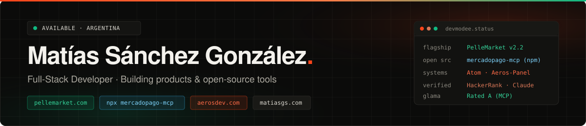

  

 

## About

I'm **Matías**, a developer from **Argentina** focused on shipping software that runs in production — from full-stack web & Android marketplaces to npm packages, lightweight Linux tooling, and Windows performance software.

- **Creator of [PelleMarket](https://pellemarket.com)** — local marketplace live on web (`v2.2`) and **[Google Play](https://play.google.com/store/apps/details?id=dev.pellemarket.app)**, presented to the Pellegrini Chamber of Commerce.
- **Author of [mercadopago-mcp](https://github.com/DevModee/mercadopago-mcp)** — read-only-by-default MCP server for Mercado Pago published on **[npm](https://www.npmjs.com/package/mercadopago-mcp)** and rated **A** on **[Glama](https://glama.ai/mcp/servers/DevModee/mercadopago-mcp)**.
- **Founder of [Aeros](https://aerosdev.com)** — home to **Atom**, **Aeros-Panel**, **EmberOS**, and production Minecraft / Hytale plugins.

 

## Featured Work

<table>
  <tr>
    <td width="50%" valign="top">
      <h3>PelleMarket <code>Live · v2.2</code></h3>
      
Local marketplace platform for Pellegrini across web, Android (Google Play), and admin panel. Features local storefronts, Mercado Pago checkout, QR digital menus, built-in chat, FCM push notifications, and E2E Playwright tests.

      
<code>Next.js</code> <code>TypeScript</code> <code>Express</code> <code>Appwrite</code> <code>Capacitor</code>

      

        <a href="https://pellemarket.com"><b>Live site ↗</b></a> ·
        <a href="https://play.google.com/store/apps/details?id=dev.pellemarket.app"><b>Google Play ↗</b></a> ·
        <a href="https://www.matiasgs.com/trabajo/pellemarket"><b>Case study ↗</b></a>
      

    </td>
    <td width="50%" valign="top">
      <h3>mercadopago-mcp <code>npm · Glama A</code></h3>
      
Read-only-by-default MCP server for Mercado Pago in TypeScript. Inspect payments, merchant orders, preferences, and verify webhook signatures (<code>x-signature</code>) locally offline; writes gated behind <code>--allow-writes</code>.

      
<code>TypeScript</code> <code>MCP SDK</code> <code>Zod</code> <code>Node.js</code>

      

        <a href="https://github.com/DevModee/mercadopago-mcp"><b>Repository ↗</b></a> ·
        <a href="https://www.npmjs.com/package/mercadopago-mcp"><b>npm ↗</b></a> ·
        <a href="https://glama.ai/mcp/servers/DevModee/mercadopago-mcp"><b>Glama (A) ↗</b></a>
      

    </td>
  </tr>
  <tr>
    <td width="50%" valign="top">
      <h3>Aeros-Panel <code>Open Source</code></h3>
      
Ultra-lightweight self-hosted Linux application manager and dashboard for low-resource servers. Replaces Docker overhead with native <code>systemd</code> services for near-zero idle footprint.

      
<code>TypeScript</code> <code>Linux</code> <code>systemd</code>

      

        <a href="https://github.com/DevModee/Aeros-Panel"><b>Repository ↗</b></a>
      

    </td>
    <td width="50%" valign="top">
      <h3>Atom &amp; Gaming Tools <code>C# · Java · Electron</code></h3>
      
<b>Atom</b> (Windows gaming performance engine measuring 1% / 0.1% lows), <b>Minecraft Server Panel</b> (Electron desktop manager), and <b>PulsePrison Core</b> (Paper/Folia plugin).

      
<code>C#</code> <code>.NET 10</code> <code>Electron</code> <code>Java</code> <code>Paper</code>

      

        <a href="https://www.matiasgs.com/trabajo/atom"><b>Atom ↗</b></a> ·
        <a href="https://github.com/DevModee/minecraft-server-panel"><b>Server Panel ↗</b></a> ·
        <a href="https://builtbybit.com/resources/pulseprison.93264/"><b>PulsePrison ↗</b></a>
      

    </td>
  </tr>
</table>

 

## Verified Certifications

[-10b981?style=for-the-badge&logo=hackerrank&logoColor=0b0b0a)](https://www.hackerrank.com/certificates/736af638eb65)

 

## Core Stack

 

 

## Activity & Stats

  

 

## Connect

